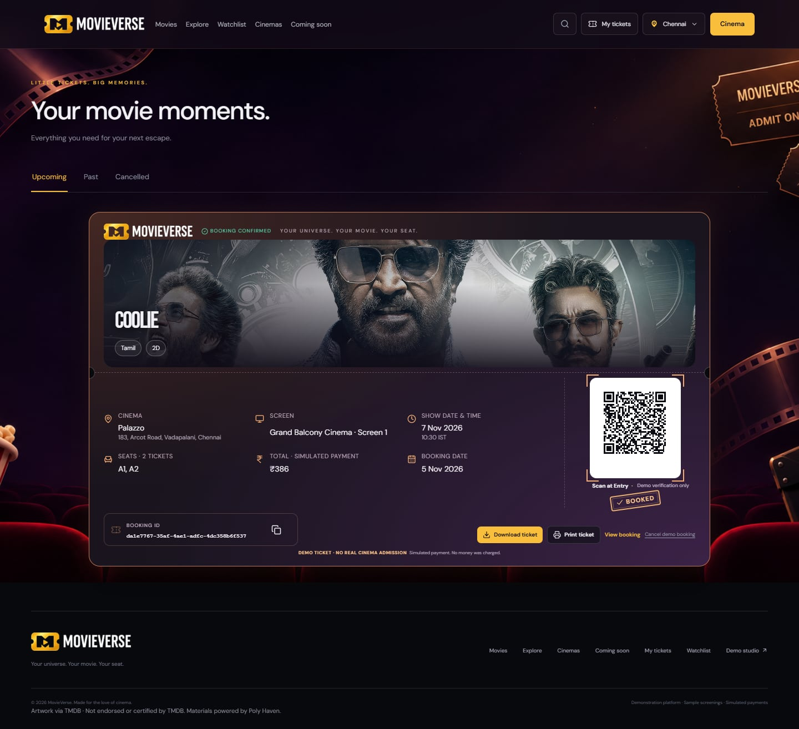
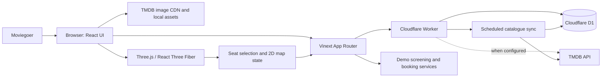

<p align="center">
  
</p>

<h1 align="center">MovieVerse</h1>

<p align="center">
  <strong>Your universe. Your movie. Your seat.</strong><br />
  Discover your next film. Step inside the theatre. Find your seat.
</p>

<p align="center">
  
  
  
  
  
</p>

<p align="center">
  <a href="#the-3d-theatre">3D theatre</a> ·
  <a href="#screenshots">Screenshots</a> ·
  <a href="#from-seats-to-a-demo-ticket">Booking experience</a> ·
  <a href="#technology">Tech stack</a> ·
  <a href="#run-locally">Run locally</a>
</p>

MovieVerse brings movie discovery and an interactive cinema booking experience together. Explore films, save a personal Watchlist, step inside a 3D auditorium, preview the screen from your chosen chair, and follow a demo booking through to a digital ticket.


<p align="center"><em>The homepage: a cinematic carousel highlighting configured demo screenings in the selected city.</em></p>

> **Portfolio demo:** Movie discovery uses TMDB when configured. Cinema bookings, inventory, snack orders, payments, and tickets are simulations; no real money is charged or cinema admission issued.

## The 3D theatre

The signature MovieVerse experience: explore a cinema auditorium before choosing your seats.


| Explore the room | Choose your seats | Preview your experience |
| --- | --- | --- |
| Overview, Balcony, Bird's Eye, guided Tour, and free camera controls. | Interactive chairs, availability indicators, seat classes, quick pick, and a 2D alternative. | Move to a selected chair's actual position and look toward the projection screen. |

The auditorium is rendered with **Three.js and React Three Fiber**. The 3D chairs, 2D map, booking summary, pricing, and backend inventory share the same seat identifiers. The balcony includes an elevated deck and selectable upper-level seating.

The screen supports official YouTube embeds and configured, authorized MP4/HLS sources. Hosted media uses a `VideoTexture`; YouTube retains its provider-owned playback and branding behaviour. Auditorium blueprints are illustrative demo layouts.

## Screenshots

A closer look at the application. Each image is a real capture stored in this repository; click a screenshot to inspect it at full size.

### Movie discovery and details

| Movies | Movie details |
| --- | --- |
| [](docs/screenshots/movies-discovery.jpg) | [](docs/screenshots/movie-details.jpg) |
| Films connected to configured cinema screenings. | Movie artwork, story, release information, and trailers. |

## From seats to a demo ticket

**Choose a screening → select seats → add snacks → review checkout → receive a demo ticket.**

### Snacks and checkout

| Add something for the movie | Review your booking |
| --- | --- |
| [](docs/screenshots/snack-selection.jpg) | [](docs/screenshots/demo-checkout.jpg) |
| Browse snacks and update quantities alongside your seat selection. | Apply or remove an offer and review the final demo amount. |

Continuing from seat selection requests an **eight-minute server-side hold**. Checkout recalculates pricing, verifies ownership and expiry, and confirms the demo booking in a D1 transaction. An idempotency key prevents repeated checkout requests from creating duplicate bookings.

### My Tickets and booking confirmation



The confirmation experience prints the ticket into view and applies the BOOKED stamp after confirmation. Saved tickets retain their booking snapshot, dynamically generated verification QR, download action, and dedicated print layout. Download produces a ticket image; browser printing also supports Save as PDF.

*The ticket screenshot uses a test account and a backend-confirmed local demo booking.*

## What MovieVerse does

| Feature | What it brings to the experience |
| --- | --- |
| **Movie discovery** | TMDB-backed collections, genre browsing, title search, regional release information, and cinematic movie details. |
| **Personal Watchlist** | Save/remove films, prevent duplicates, and synchronize saved state across pages against an authenticated account. |
| **Cinema discovery** | City-aware venue directory, individual cinema pages, and separately configured demo screenings. |
| **Interactive seat selection** | 3D auditorium, camera presets, actual-seat previews, class-aware pricing, quick pick, and 2D map. |
| **Booking and checkout** | Timed holds, snacks, single-coupon pricing, itemized totals, and explicit simulated payment outcomes. |
| **Digital tickets** | Confirmation animation, saved booking details, QR verification, image download, and print preparation. |
| **Accounts** | Registration, sign-in, custom profile photos, persistent Watchlists, and owned booking history. |

**Movies** answers “What can I watch in a cinema?” using configured screenings. **Explore** answers “What movies are worth discovering?” using the broader discovery catalogue. A film appearing in Explore does not establish local booking availability.

---

## Technology

| Layer | Technology | Role in MovieVerse |
| --- | --- | --- |
| UI | React 19.2, Vinext 1.0 beta, Vite 8 | React application using Next.js-style App Router APIs, built and run through Vinext/Vite. This is not a conventional Next.js server deployment. |
| Language | TypeScript 5.9 | Typed UI, API, catalogue, and booking logic. |
| 3D | Three.js 0.187, React Three Fiber 9.8, Drei 10.7 | Auditorium rendering, camera controls, projection surface, and interactive seats. |
| State and forms | Zustand 5, React Hook Form, Zod | Shared client state and validation for user input/configuration. |
| Styling | Tailwind CSS 4 and authored CSS | Shared styling utilities and page/component-specific layouts. |
| Runtime and API | Cloudflare Workers, `@cloudflare/vite-plugin`, Wrangler 4 | Server-side request handling, scheduled Worker entry point, and Cloudflare-compatible builds. |
| Database | Cloudflare D1 (SQLite), Drizzle ORM 0.45 | Persistent accounts, sessions, watchlists, booking inventory, catalogue, and migrations. |
| Movie data | TMDB API and TMDB image CDN | Server-side movie discovery/metadata and movie artwork. TMDB does not provide MovieVerse cinema inventory. |
| Video | YouTube IFrame Player API, HTML video, HLS.js 1.7, Three.js `VideoTexture` | Official embedded trailers and authorized hosted-media playback paths. |
| Verification | Vitest 5, Playwright 1.64, ESLint 9 | Unit tests, browser flows, and linting. |

## Architecture



`app/` contains the application entry point and API routes. The Worker in `worker/index.ts` serves requests through Vinext; the external Node.js 24 importer owns catalogue refresh work. Server routes use the existing D1 binding for persistent data; the browser does not receive TMDB credentials. `components/` contains the UI, while `components/auditorium/` holds the 3D theatre pieces. Domain logic for bookings, discovery, media, and Watchlist lives in `lib/`; database schema and SQL migrations are under `db/` and `drizzle/`.

## Data freshness and booking availability

MovieVerse includes a D1-backed, resumable TMDB catalogue importer. GitHub Actions runs a full catalogue sync daily at `0 3 * * *` UTC and a trending refresh every six hours at `0 */6 * * *` UTC. The external Node.js 24 process performs TMDB requests and orchestration; the Worker accepts authenticated prepared batches and performs D1 ingestion/publication only. Public pages cache catalogue responses briefly.

The importer requires `MOVIEVERSE_URL`, `ADMIN_TOKEN`, and `TMDB_READ_TOKEN`. The Worker ingestion endpoint requires the existing `ADMIN_TOKEN`; it does not need a new secret. Keep the existing Worker `TMDB_READ_TOKEN` if protected diagnostics or legacy compatibility endpoints are still used, but the external importer reads TMDB through its own environment. Production import freshness must be verified in GitHub Actions and the protected Worker status endpoint after deployment.

The homepage booking carousel has a separate rule: it selects movies with future configured **demo screenings** and available illustrative inventory for the selected city. A new movie arriving from TMDB will appear in discovery after sync, but it will **not** automatically gain a cinema, showtime, seats, or a real booking. Those require a licensed cinema inventory and transaction integration, or an operator to configure a demo screening.

## Run locally

### Prerequisites

- Node.js 22.13 or later
- npm
- Git

### Fresh clone

```powershell
git clone https://github.com/saad4228/MovieVerse.git
cd MovieVerse
npm install
```

The demo can start without a TMDB key. To enable server-side TMDB requests locally, create an ignored `.dev.vars` file in the project root and add one of the variables in the table below. Keep the value private and restart the development server after changing it.

Build the Worker configuration before applying migrations to a **fresh local D1 database**:

```powershell
npm run build
npm run db:local
npm run dev
```

Open the local URL printed by Vinext (normally `http://127.0.0.1:5173`). Local D1 state is stored under the ignored `.wrangler/` directory. If you already have a local database from an older version, do not delete it or replay the initial migrations blindly; first reconcile its migration baseline. `npm run start` previews the built Worker locally.

Keep an existing `.dev.vars` and `.wrangler/state` intact. The safe setup and publication checklist is in [repository security](docs/REPOSITORY_SECURITY.md); never upload a complete local folder containing secrets, database files or browser traces.

To populate Explore on a fresh local database, configure your private TMDB credential and run the shared importer from a separate terminal:

```powershell
node --experimental-transform-types scripts/sync-catalogue-local.mjs
node --experimental-transform-types scripts/sync-catalogue-local.mjs --status
```

The initial import can take several minutes. This helper operates on local D1; production setup and scheduled-run verification are documented in [Dynamic catalogue](docs/DYNAMIC_CATALOGUE.md).

### External production importer

Set the endpoint and read the two importer secrets without echoing them:

```powershell
function Read-MovieVerseSecret([string] $Name) {
  $secure = Read-Host $Name -AsSecureString
  $pointer = [Runtime.InteropServices.Marshal]::SecureStringToBSTR($secure)
  try { return [Runtime.InteropServices.Marshal]::PtrToStringBSTR($pointer) }
  finally { [Runtime.InteropServices.Marshal]::ZeroFreeBSTR($pointer) }
}

$env:MOVIEVERSE_URL = "https://movieverse.saad4228.workers.dev"
$env:ADMIN_TOKEN = Read-MovieVerseSecret "ADMIN_TOKEN"
$env:TMDB_READ_TOKEN = Read-MovieVerseSecret "TMDB_READ_TOKEN"
```

Trending-only import:

```powershell
node --experimental-transform-types --loader ./scripts/local-ts-loader.mjs scripts/sync-catalogue-remote.mjs --trending
```

Start a new full import:

```powershell
Remove-Item Env:\MOVIEVERSE_RUN_ID -ErrorAction SilentlyContinue
node --experimental-transform-types --loader ./scripts/local-ts-loader.mjs scripts/sync-catalogue-remote.mjs
```

Resume an existing import:

```powershell
$runId = Read-Host "Existing catalogue run UUID"
node --experimental-transform-types --loader ./scripts/local-ts-loader.mjs scripts/sync-catalogue-remote.mjs --run-id $runId
```

The shared GitHub Actions workflow uses the same commands, Node.js 24, and one non-cancelling concurrency group for full and trending imports.

## Environment variables

Put local Worker values in ignored `.dev.vars`. In production, configure secrets through the Worker host’s secret settings; never use `NEXT_PUBLIC_*` or `VITE_*` for credentials.

| Variable | Required? | Purpose |
| --- | --- | --- |
| `TMDB_READ_TOKEN` | Optional; preferred for live TMDB calls | TMDB API Read Access Token used by server-side discovery and catalogue sync. |
| `TMDB_API_KEY` | Optional alternative | TMDB v3 API key, used when `TMDB_READ_TOKEN` is not set. Configure one TMDB credential, not both. |
| `ADMIN_TOKEN` | Optional | Protects Demo Studio publishing operations. Set only as a backend secret. |
| `SHOWTIMES_MODE` | Optional; defaults to `directory` | `directory` lists cinema directory entries without asserting showtimes; `production` selects the approved provider adapter. |
| `LIVE_SHOWTIMES_APPROVED` | Required for production showtime adapter | Explicit operator approval flag after provider licensing, coverage, and ID mappings are in place. |
| `LIVE_SHOWTIMES_ENDPOINT` | Required for production showtime adapter | HTTPS URL for a licensed provider feed normalized to the MovieVerse contract. |
| `LIVE_SHOWTIMES_TOKEN` | Optional, provider-dependent | Server-side authorization token for that feed. |
| `TEST_BASE_URL` | Optional, tests only | Base URL for browser tests; defaults to the local app URL. |

Cloudflare D1 is bound as `DB`; it is not configured with a database URL. Before deploying your own Worker, replace the placeholder D1/Worker deployment values with your own Cloudflare resources and apply migrations. TMDB access alone does not activate cinema showtimes or payment processing.

## Production deployment runbook

Run these commands from the repository root in PowerShell. They do not print secret values.

### Build and verify the Worker

The build script is the repository's `build` script and generates the production Wrangler configuration at `dist/server/wrangler.json`:

```powershell
npm run build
Get-Content .\dist\server\wrangler.json -Raw | ConvertFrom-Json |
  Select-Object name,d1_databases,triggers
npx wrangler deploy --dry-run --config .\dist\server\wrangler.json
```

The generated configuration must bind `DB` to the intended MovieVerse D1 and contain no catalogue Cron triggers. Catalogue schedules belong to GitHub Actions.

### Verify the production D1

Authenticate to the intended Cloudflare account first:

```powershell
npx wrangler login
npx wrangler whoami
```

List remote databases and inspect the configured database identity:

```powershell
npx wrangler d1 list --json
npx wrangler d1 info site-creator-d1 --json
Get-Content .\dist\server\wrangler.json -Raw | ConvertFrom-Json |
  Select-Object -ExpandProperty d1_databases
```

Confirm that the configured name and ID identify MovieVerse production. Do not select `dropby-db`, create a duplicate database, or proceed if the identity is ambiguous.

### Back up D1 before migration

Create a local backup directory and export the remote production database before applying migrations:

```powershell
New-Item -ItemType Directory -Force .\backups | Out-Null
$backup = ".\backups\movieverse-site-creator-d1-$(Get-Date -Format yyyyMMdd-HHmmss).sql"
npx wrangler d1 export site-creator-d1 --remote `
  --output $backup `
  --config .\dist\server\wrangler.json
```

Keep the backup outside commits and do not upload it to the repository.

### Review and apply migrations

Review the remote migration history before any write:

```powershell
npx wrangler d1 migrations list DB --remote `
  --config .\dist\server\wrangler.json
```

After confirming that the only pending migrations are `0006_resumable_catalogue.sql` and `0007_resumable_coordination.sql`, apply pending migrations through the configured `DB` binding. Wrangler applies them in filename order:

```powershell
npx wrangler d1 migrations apply DB --remote `
  --config .\dist\server\wrangler.json
```

Verify the migration history again:

```powershell
npx wrangler d1 migrations list DB --remote `
  --config .\dist\server\wrangler.json
```

Do not run individual migration SQL files directly or replay earlier migrations against an existing database. Keep `ADMIN_TOKEN` unchanged.

### Deploy the Worker

Deploy only after the D1 backup, migration review, and successful dry run:

```powershell
npx wrangler deploy --config .\dist\server\wrangler.json
```

### Run the GitHub Actions importer

The workflow runs from the repository default branch, currently `main`. Configure these repository secrets without exposing their values:

- `MOVIEVERSE_URL`
- `ADMIN_TOKEN`
- `TMDB_READ_TOKEN`

Start a trending import manually:

```powershell
gh workflow run catalogue-sync.yml `
  --repo saad4228/MovieVerse `
  --ref main `
  --field mode=trending
```

After the trending run succeeds, start a full import:

```powershell
gh workflow run catalogue-sync.yml `
  --repo saad4228/MovieVerse `
  --ref main `
  --field mode=full
```

To resume a known run from the manual workflow:

```powershell
$runId = Read-Host "Existing catalogue run UUID"
gh workflow run catalogue-sync.yml `
  --repo saad4228/MovieVerse `
  --ref main `
  --field mode=full `
  --field run_id=$runId
```

The workflow's shared concurrency group has `cancel-in-progress: false`; full and trending imports cannot overlap.

### Verify the trending import

First inspect the workflow result:

```powershell
gh run list --repo saad4228/MovieVerse `
  --workflow catalogue-sync.yml `
  --limit 5
```

The selected trending run must finish successfully. Then inspect the protected catalogue status without printing the token:

```powershell
$env:MOVIEVERSE_URL = "https://movieverse.saad4228.workers.dev"
$admin = Read-Host "Production ADMIN_TOKEN" -AsSecureString
$pointer = [Runtime.InteropServices.Marshal]::SecureStringToBSTR($admin)
try {
  $token = [Runtime.InteropServices.Marshal]::PtrToStringBSTR($pointer)
  $status = Invoke-RestMethod `
    -Uri "$env:MOVIEVERSE_URL/api/catalogue-status" `
    -Headers @{ Authorization = "Bearer $token" }
  $status | ConvertTo-Json -Depth 20
} finally {
  [Runtime.InteropServices.Marshal]::ZeroFreeBSTR($pointer)
  Remove-Variable token -ErrorAction SilentlyContinue
}
```

Confirm that:

- the latest trending run is `success`;
- the expected trending collections are present with nonzero or explicitly valid empty collection counts;
- each refreshed collection has a new active publication generation;
- `resumable.batches.failed` is `0`;
- `itemFailures` is empty;
- no collection remains unexpectedly `running`, `pending`, or `publishing`;
- the Worker logs show authenticated batch ingestion/publication only.

The Node.js 24 process performs TMDB fetching, JSON parsing, validation, normalization, collection planning, enrichment, and orchestration. The Worker performs authenticated D1 batch ingestion, fencing/lease checks, generation staging, and atomic publication only.

## Useful commands

| Command | Purpose |
| --- | --- |
| `npm run dev` | Start local development. |
| `npm run build` | Build the Worker and application. |
| `npm run start` | Run the built Worker locally with Wrangler. |
| `npm run db:local` | Apply pending Drizzle migrations to fresh local D1 state. |
| `npm run db:generate` | Generate migrations from schema changes. |
| `npm run typecheck` | Run TypeScript checks. |
| `npm run lint` | Run ESLint. |
| `npm test` | Run Vitest unit tests. |
| `npm run test:e2e` | Run Playwright browser tests; install Chromium with `npx playwright install chromium` if needed. |
| `npm run security:check` | Scan publishable source for secret patterns and private/generated paths. |
| `npm run security:history` | Scan locally reachable historical text blobs without changing history. |
| `npm run security:test` | Test the dependency-free repository security tooling. |

**Local verification on 5 November 2026:** TypeScript passed; Vitest passed (23 files, 149 tests); the production build completed with bundle-size and Vinext route-classification warnings. ESLint reports 160 errors and 71 warnings, down from 190 and 73 before cleanup. The broad Playwright run recorded 99 passing, 31 failing, and one skipped test; subsequent focused runs verified corrections but the complete suite is not green. See the [code-quality audit](docs/CODE_QUALITY_AUDIT.md) for fixes, test scope, remaining issues, and an interview guide.

## Project layout

```text
app/                    App Router entry points and API routes
components/             Shared pages and interactive UI
components/auditorium/  3D theatre, screen, seats, and camera
data/                   Catalogue, directory, media, and demo configuration
db/                     Drizzle database schema
docs/                   Engineering notes and integration contracts
docs/screenshots/        Compressed MovieVerse application captures
drizzle/                D1 SQL migrations and Drizzle metadata
lib/                    Discovery, booking, auth, media, and domain logic
public/assets/          Local visual assets, fonts, logos, and fallbacks
scripts/                Build, local tooling, sync, and verification helpers
tests/                  Unit and Playwright browser tests
worker/index.ts          Cloudflare Worker request and scheduled handlers
```

## Demo boundaries and integrations

- Movie discovery metadata and artwork can come from TMDB when configured. Movie pages and release dates do not establish local availability.
- Cinema directories are informational. Demo screening schedules and seat inventory are not supplied by a cinema chain.
- The showtime adapter has a separate production boundary for an authorized provider. Production mode requires approval, a mapped and fresh provider response, and a licensed feed. No provider coverage should be inferred from the sample directory.
- Booking, seat holds, snacks, checkout outcomes, and generated tickets are demonstrations. No real payment provider, cinema ticketing system, food fulfilment, or email delivery is configured.
- A genuine deployment needs commercial/provider approvals, production D1 setup and migrations, scheduled-sync verification, and separate live inventory/booking/payment integrations.

## Engineering notes

- [Dynamic movie catalogue and refresh setup](docs/DYNAMIC_CATALOGUE.md)
- [TMDB, media, and licensed showtime integrations](docs/INTEGRATIONS.md)
- [3D theatre playback architecture](docs/CINEMA_PLAYBACK.md)
- [Seat-selection workspace](docs/SEAT_WORKSPACE.md)
- [Watchlist storage and API](docs/WATCHLIST.md)
- [Artwork and media credits](docs/ASSET_CREDITS.md)
- [Code-quality audit and interview walkthrough](docs/CODE_QUALITY_AUDIT.md)
- [Security policy and private reporting](SECURITY.md)
- [Dependency security audit and remediation](docs/DEPENDENCY_SECURITY_REMEDIATION.md)
- [Safe environment setup and repository checks](docs/REPOSITORY_SECURITY.md)
- [Approved repository cleanup report](docs/REPOSITORY_SECURITY_CLEANUP.md)

## Next steps

- Verify scheduled catalogue refreshes against the deployed Worker and production D1 bindings.
- Connect an approved cinema inventory provider, including venue/show mappings, live holds, and booking confirmation.
- Add a production payment provider and reconcile payment webhooks with booking state.
- Resolve the remaining strict lint findings and maintain browser coverage as the dynamic catalogue changes.
- Continue testing the auditorium on ordinary hardware; software WebGL tests do not establish hardware FPS.

## Contributing

Keep changes focused and explain the user-visible problem, implementation, and verification in the pull request. Run the relevant unit/browser checks, type checking, and production build. Preserve demo labels and provider boundaries. Add regression coverage for fixes to authentication, holds, pricing, or account-specific data; keep credentials and local database state out of commits.

## Code and asset rights

No open-source license is granted for MovieVerse application code. Permission to reuse, modify or redistribute that code has not been granted. Existing third-party licenses and asset terms remain applicable to their respective material; no rights to movie artwork, trailers or trademarks are granted by this repository.

## Attribution

MovieVerse uses the TMDB API and TMDB artwork. **This product uses the TMDB API but is not endorsed or certified by TMDB.** See [TMDB](https://www.themoviedb.org/) and the [TMDB API documentation](https://developer.themoviedb.org/docs). Movie and promotional artwork remains subject to its respective rights holders; see [asset credits](docs/ASSET_CREDITS.md).
