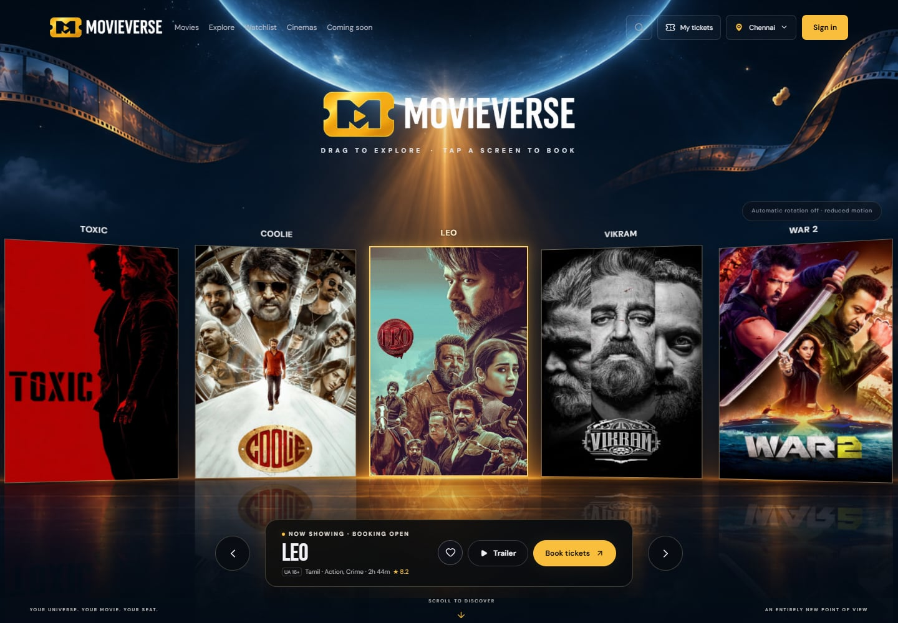
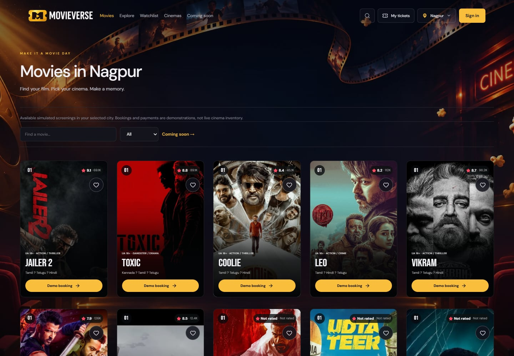
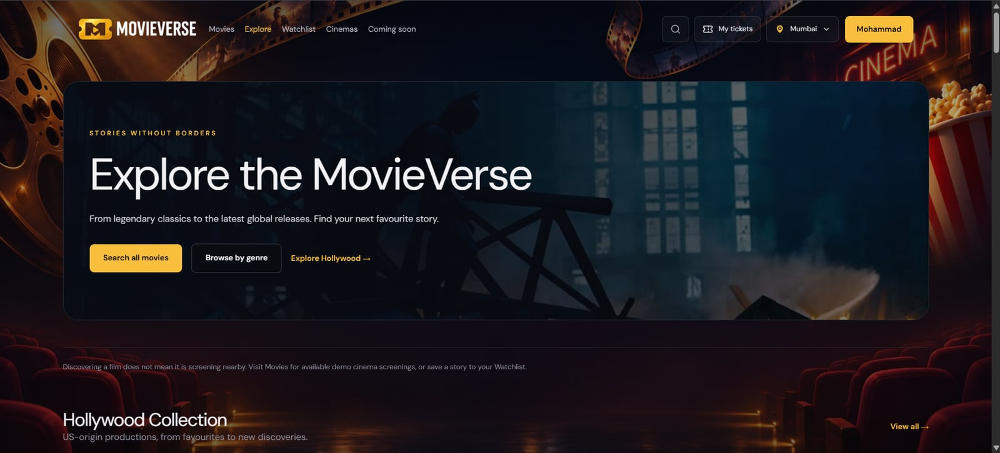
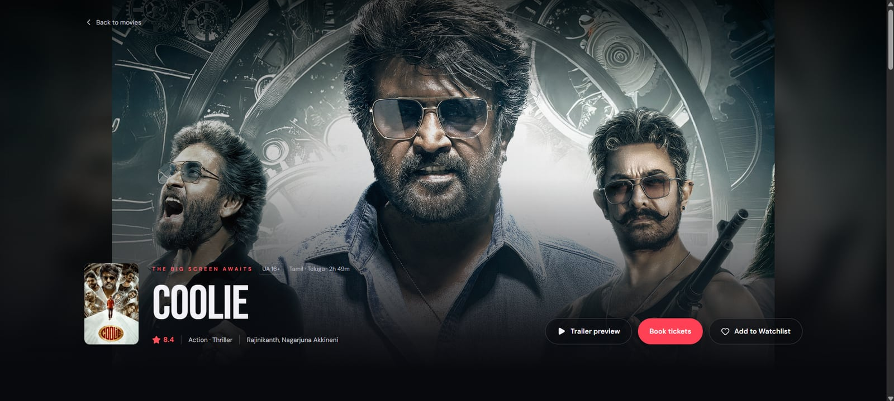
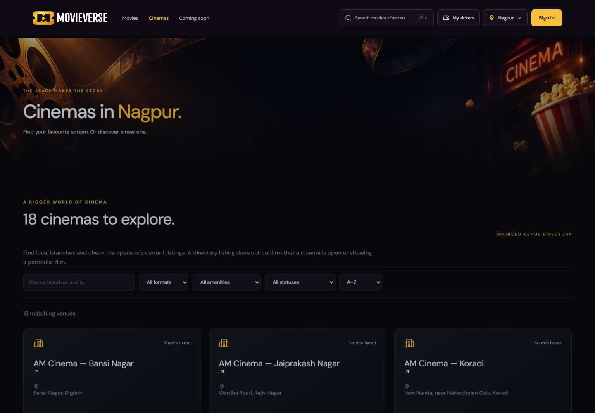
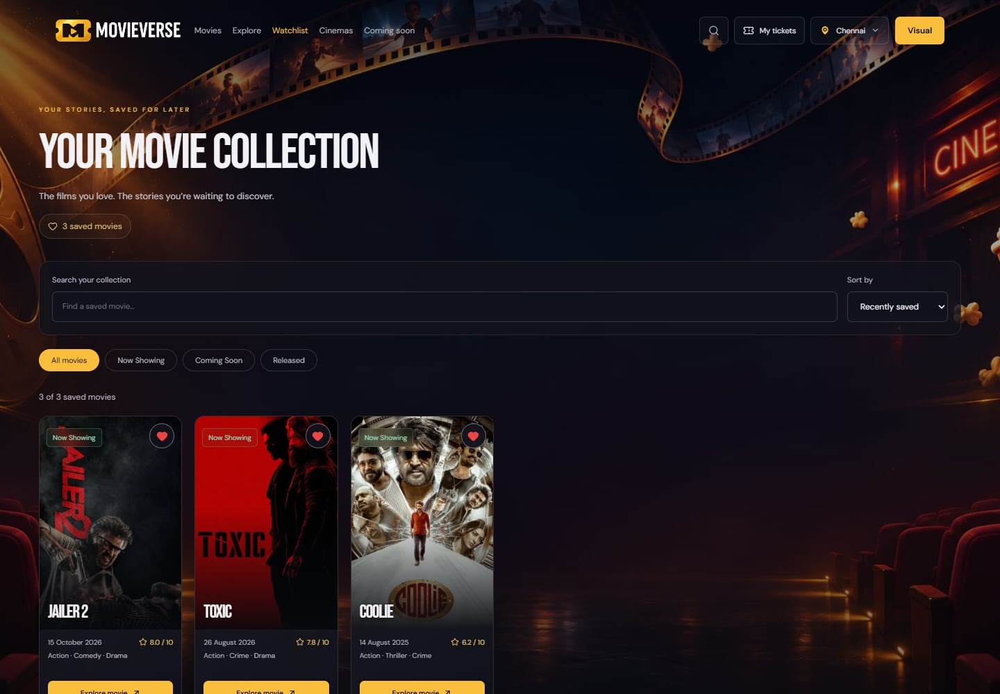
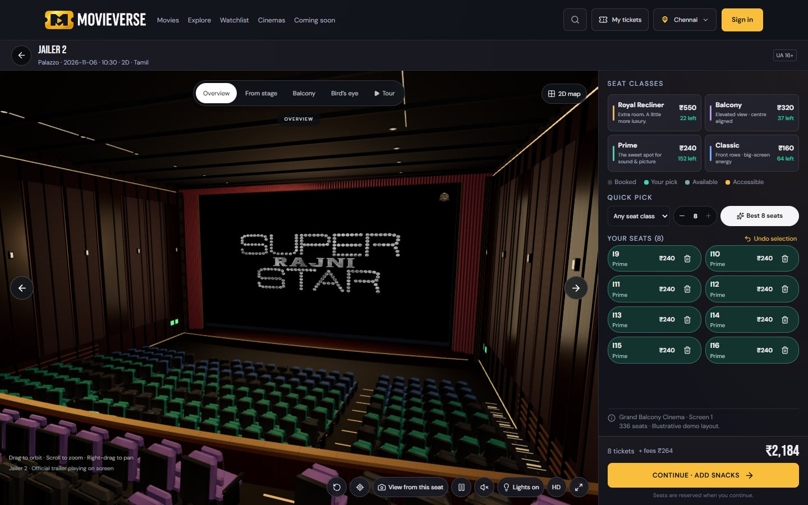
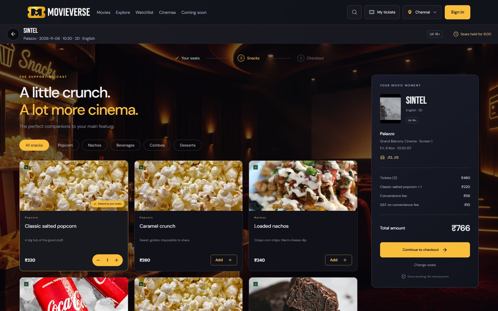
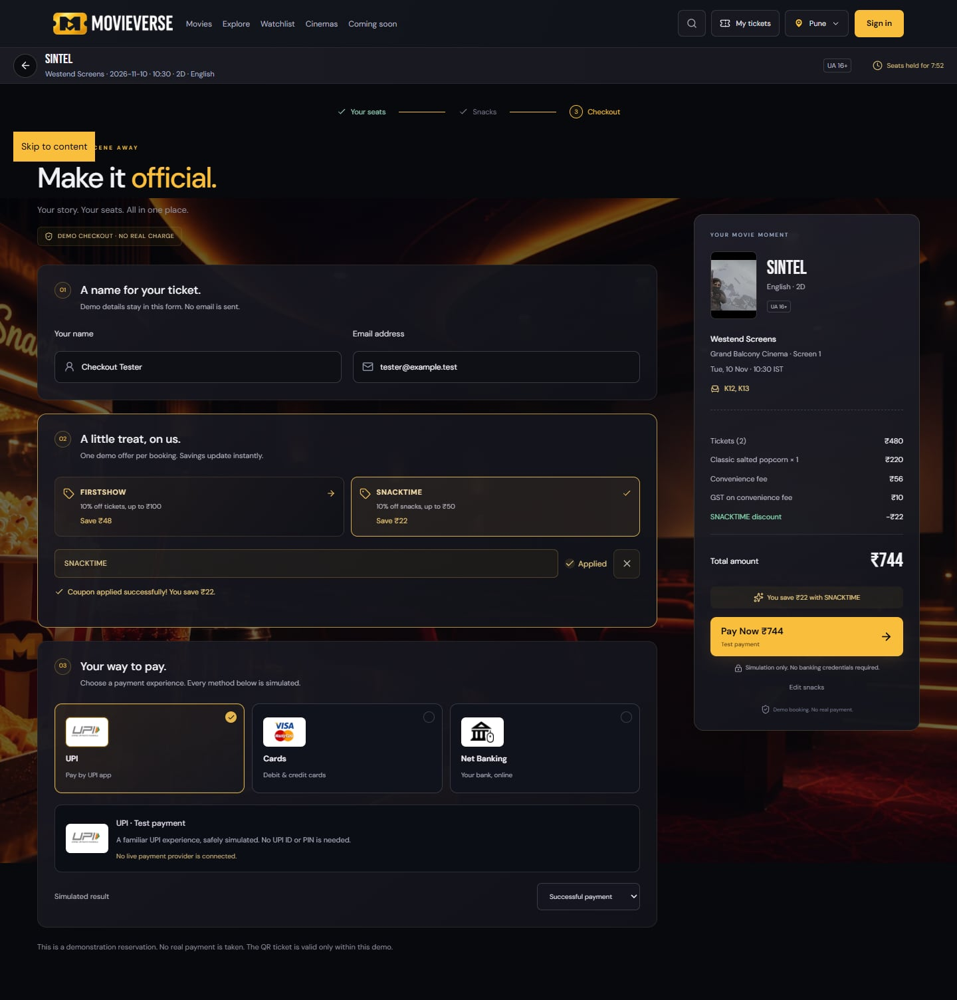
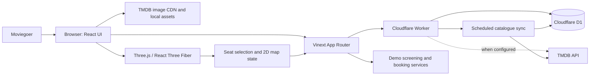

<p align="center">
  
</p>

<h1 align="center">MovieVerse</h1>

<p align="center"><strong>Your universe. Your movie. Your seat.</strong><br />Movie discovery meets an interactive cinema booking demo.</p>

<p align="center">
  <a href="https://github.com/saad4228/MovieVerse"></a>
  <a href="https://github.com/saad4228/MovieVerse"></a>
  <a href="https://github.com/saad4228/MovieVerse"></a>
  <a href="https://github.com/saad4228/MovieVerse"></a>
  <a href="https://github.com/saad4228/MovieVerse"></a>
</p>

<p align="center">
  <a href="#screenshots">Screenshots</a> ·
  <a href="#what-movieverse-does">What it does</a> ·
  <a href="#technology">Technology</a> ·
  <a href="#run-locally">Run locally</a> ·
  <a href="#data-freshness-and-booking-availability">Data freshness</a>
</p>

MovieVerse brings the cinema journey into one place: discover films, find a screening in the demo catalogue, explore a 3D auditorium, choose seats, add snacks, and follow a simulated checkout through to a digital ticket. It is a portfolio project focused on the experience and engineering of movie discovery and seat selection.

> **Demo platform:** MovieVerse does not currently sell real cinema tickets or process real payments. Showtimes, seat inventory, snack orders, and checkout outcomes are clearly illustrative. TMDB movie metadata does not confirm that a film is screening in a particular cinema.

## Screenshots

These are compressed captures of the MovieVerse application. Booking and checkout images show the demo flow.

<table>
  <tr>
    <td width="50%"><strong>Homepage · bookable demo screenings</strong><br /></td>
    <td width="50%"><strong>Movies · browse and discover</strong><br /></td>
  </tr>
  <tr>
    <td><strong>Explore · wider movie collections</strong><br /></td>
    <td><strong>Movie details</strong><br /></td>
  </tr>
  <tr>
    <td><strong>Cinemas · venue discovery</strong><br /></td>
    <td><strong>Watchlist · saved films</strong><br /></td>
  </tr>
  <tr>
    <td><strong>3D theatre · interactive seat selection</strong><br /></td>
    <td><strong>Snacks · demo order flow</strong><br /></td>
  </tr>
  <tr>
    <td colspan="2"><strong>Checkout · payment interface in demo mode</strong><br /></td>
  </tr>
</table>

## What MovieVerse does

MovieVerse separates two different user needs:

| Area | Question it answers | What the data means |
| --- | --- | --- |
| **Movies** | “What can I watch in a cinema?” | Movies connected to MovieVerse screening records. Until a licensed inventory provider is connected, these are labelled demo screenings. |
| **Explore** | “What movies are worth discovering?” | A broader catalogue of films and collections. A listing here does not imply a local screening or booking availability. |

### Movie discovery

- Browse movies, search titles, explore genres, and view movie details.
- Discover curated collections across Indian, Hindi-language, Hollywood, and international cinema.
- Use the TMDB-backed discovery catalogue when the server-side integration and catalogue sync are configured.
- Save and remove movies from a personal Watchlist.

### Cinema journey

- Browse cinemas and switch between supported city directories.
- Enter the illustrative booking flow through a configured demo screening.
- Select seats in a Three.js auditorium or use the 2D seat map.
- Review seat classes, pricing, and selections; continue to snacks and a demo checkout.
- View a booking confirmation and digital ticket for a simulated booking.

### Accounts and preferences

- Register and sign in to a MovieVerse account.
- Save a Watchlist to the signed-in account.
- Keep browsing preferences and guest booking state in the application’s supported session/local storage flows.

## The 3D theatre

The auditorium is rendered in the browser with React Three Fiber and Three.js. Auditorium layouts describe rows, aisles, screen dimensions, seat identifiers, and seating categories; the renderer turns those descriptions into interactive geometry. Seat selection is connected to the same booking summary and inventory checks used by the 2D map.

Camera presets, orbit/zoom/pan, selected-seat previews, category-aware pricing, and a 2D alternative support different ways to explore the room. The projection surface can show official YouTube embeds or configured, authorized hosted MP4/HLS media. Hosted video uses an HTML video element and Three.js `VideoTexture`; YouTube remains subject to YouTube’s own branding, embedding, and playback behaviour. Media playback is not a source of ticket or showtime data.

The supplied auditorium blueprints and demo inventory are illustrative. They are not measured architectural plans or a connection to a cinema’s live seat map.

## Technology

| Layer | Technology | Role in MovieVerse |
| --- | --- | --- |
| UI | React 19.2, Vinext 1.0 beta, Vite 8 | React application using Next.js-style App Router APIs, built and run through Vinext/Vite. This is not a conventional Next.js server deployment. |
| Language | TypeScript 5.9 | Typed UI, API, catalogue, and booking logic. |
| 3D | Three.js 0.187, React Three Fiber 9.8, Drei 10.7 | Auditorium rendering, camera controls, projection surface, and interactive seats. |
| State and forms | Zustand 5, React Hook Form, Zod | Shared client state and validation for user input/configuration. |
| Styling | Tailwind CSS 4 and authored CSS | Shared styling utilities and page/component-specific layouts. |
| Runtime and API | Cloudflare Workers, `@cloudflare/vite-plugin`, Wrangler 4 | Server-side request handling, scheduled Worker entry point, and Cloudflare-compatible builds. |
| Database | Cloudflare D1 (SQLite), Drizzle ORM 0.45 | Persistent accounts, sessions, watchlists, booking inventory, catalogue, and migrations. |
| Movie data | TMDB API and TMDB image CDN | Server-side movie discovery/metadata and movie artwork. TMDB does not provide MovieVerse cinema inventory. |
| Video | YouTube IFrame Player API, HTML video, HLS.js 1.7, Three.js `VideoTexture` | Official embedded trailers and authorized hosted-media playback paths. |
| Verification | Vitest 5, Playwright 1.64, ESLint 9 | Unit tests, browser flows, and linting. |

## Architecture



`app/` contains the application entry point and API routes. The Worker in `worker/index.ts` serves requests through Vinext and owns scheduled catalogue refresh work. Server routes use the existing D1 binding for persistent data; the browser does not receive TMDB credentials. `components/` contains the UI, while `components/auditorium/` holds the 3D theatre pieces. Domain logic for bookings, discovery, media, and Watchlist lives in `lib/`; database schema and SQL migrations are under `db/` and `drizzle/`.

## Data freshness and booking availability

MovieVerse includes a D1-backed TMDB catalogue importer and Worker cron handlers: a full catalogue sync is scheduled daily at `0 3 * * *` UTC, with a trending refresh every six hours at `0 */6 * * *` UTC. Public pages cache catalogue responses briefly, so a currently open page may take a few minutes to reflect a completed sync.

Those handlers refresh discovery metadata only when the deployed Worker has a valid server-side TMDB credential, the intended D1 database binding, scheduled triggers enabled, and enough runtime quota. **The code and schedule do not by themselves prove that a production deployment or its cron runs are configured.** Production import freshness must be verified in Cloudflare after deployment.

The homepage booking carousel has a separate rule: it selects movies with future configured **demo screenings** and available illustrative inventory for the selected city. A new movie arriving from TMDB will appear in discovery after sync, but it will **not** automatically gain a cinema, showtime, seats, or a real booking. Those require a licensed cinema inventory and transaction integration, or an operator to configure a demo screening.

## Run locally

### Prerequisites

- Node.js 22.13 or later
- npm
- Git

### Fresh clone

```powershell
git clone https://github.com/saad4228/MovieVerse.git
cd MovieVerse
npm install
```

The demo can start without a TMDB key. To enable server-side TMDB requests locally, create an ignored `.dev.vars` file in the project root and add one of the variables in the table below. Keep the value private and restart the development server after changing it.

Build the Worker configuration before applying migrations to a **fresh local D1 database**:

```powershell
npm run build
npm run db:local
npm run dev
```

Open the local URL printed by Vinext (normally `http://127.0.0.1:5173`). Local D1 state is stored under the ignored `.wrangler/` directory. If you already have a local database from an older version, do not delete it or replay the initial migrations blindly; first reconcile its migration baseline. `npm run start` previews the built Worker locally.

## Environment variables

Put local Worker values in ignored `.dev.vars`. In production, configure secrets through the Worker host’s secret settings; never use `NEXT_PUBLIC_*` or `VITE_*` for credentials.

| Variable | Required? | Purpose |
| --- | --- | --- |
| `TMDB_READ_TOKEN` | Optional; preferred for live TMDB calls | TMDB API Read Access Token used by server-side discovery and catalogue sync. |
| `TMDB_API_KEY` | Optional alternative | TMDB v3 API key, used when `TMDB_READ_TOKEN` is not set. Configure one TMDB credential, not both. |
| `ADMIN_TOKEN` | Optional | Protects Demo Studio publishing operations. Set only as a backend secret. |
| `SHOWTIMES_MODE` | Optional; defaults to `directory` | `directory` lists cinema directory entries without asserting showtimes; `production` selects the approved provider adapter. |
| `LIVE_SHOWTIMES_APPROVED` | Required for production showtime adapter | Explicit operator approval flag after provider licensing, coverage, and ID mappings are in place. |
| `LIVE_SHOWTIMES_ENDPOINT` | Required for production showtime adapter | HTTPS URL for a licensed provider feed normalized to the MovieVerse contract. |
| `LIVE_SHOWTIMES_TOKEN` | Optional, provider-dependent | Server-side authorization token for that feed. |
| `TEST_BASE_URL` | Optional, tests only | Base URL for browser tests; defaults to the local app URL. |

Cloudflare D1 is bound as `DB`; it is not configured with a database URL. Before deploying your own Worker, replace the placeholder D1/Worker deployment values with your own Cloudflare resources and apply migrations. TMDB access alone does not activate cinema showtimes or payment processing.

## Useful commands

| Command | Purpose |
| --- | --- |
| `npm run dev` | Start local development. |
| `npm run build` | Build the Worker and application. |
| `npm run start` | Run the built Worker locally with Wrangler. |
| `npm run db:local` | Apply pending Drizzle migrations to fresh local D1 state. |
| `npm run db:generate` | Generate migrations from schema changes. |
| `npm run typecheck` | Run TypeScript checks. |
| `npm run lint` | Run ESLint. |
| `npm test` | Run Vitest unit tests. |
| `npm run test:e2e` | Run Playwright browser tests; install Chromium with `npx playwright install chromium` if needed. |

**Local verification on 5 November 2026:** TypeScript passed; Vitest passed (21 files, 138 tests); the production build completed with bundle-size and Vinext route-classification warnings. ESLint currently reports 190 errors and 73 warnings across the repository. The full Playwright suite was not run in this publish pass.

## Project layout

```text
app/                    App Router entry points and API routes
components/             Shared pages and interactive UI
components/auditorium/  3D theatre, screen, seats, and camera
data/                   Catalogue, directory, media, and demo configuration
db/                     Drizzle database schema
docs/                   Engineering notes and integration contracts
docs/screenshots/        Compressed MovieVerse application captures
drizzle/                D1 SQL migrations and Drizzle metadata
lib/                    Discovery, booking, auth, media, and domain logic
public/assets/          Local visual assets, fonts, logos, and fallbacks
scripts/                Build, local tooling, sync, and verification helpers
tests/                  Unit and Playwright browser tests
worker/index.ts          Cloudflare Worker request and scheduled handlers
```

## Demo boundaries and integrations

- Movie discovery metadata and artwork can come from TMDB when configured. Movie pages and release dates do not establish local availability.
- Cinema directories are informational. Demo screening schedules and seat inventory are not supplied by a cinema chain.
- The showtime adapter has a separate production boundary for an authorized provider. Production mode requires approval, a mapped and fresh provider response, and a licensed feed. No provider coverage should be inferred from the sample directory.
- Booking, seat holds, snacks, checkout outcomes, and generated tickets are demonstrations. No real payment provider, cinema ticketing system, food fulfilment, or email delivery is configured.
- A genuine deployment needs commercial/provider approvals, production D1 setup and migrations, scheduled-sync verification, and separate live inventory/booking/payment integrations.

## Engineering notes

- [Dynamic movie catalogue and refresh setup](docs/DYNAMIC_CATALOGUE.md)
- [TMDB, media, and licensed showtime integrations](docs/INTEGRATIONS.md)
- [3D theatre playback architecture](docs/CINEMA_PLAYBACK.md)
- [Seat-selection workspace](docs/SEAT_WORKSPACE.md)
- [Watchlist storage and API](docs/WATCHLIST.md)
- [Artwork and media credits](docs/ASSET_CREDITS.md)

## Attribution

MovieVerse uses the TMDB API and TMDB artwork. **This product uses the TMDB API but is not endorsed or certified by TMDB.** See [TMDB](https://www.themoviedb.org/) and the [TMDB API documentation](https://developer.themoviedb.org/docs). Movie and promotional artwork remains subject to its respective rights holders; see [asset credits](docs/ASSET_CREDITS.md).
